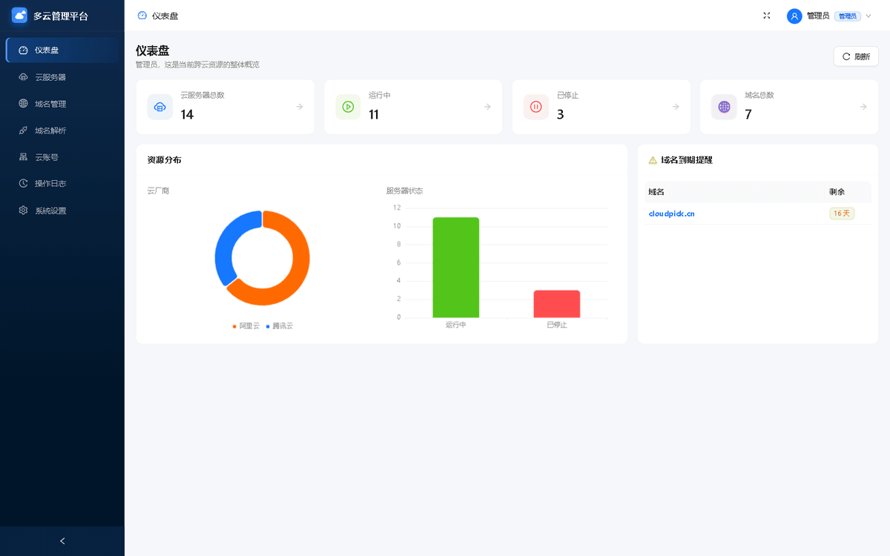
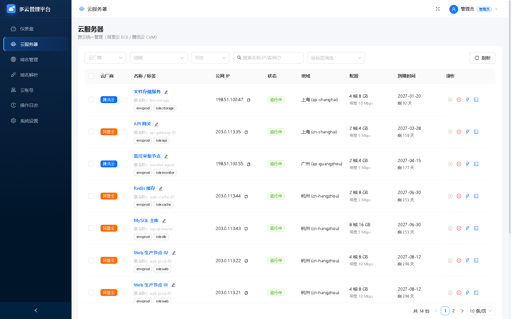
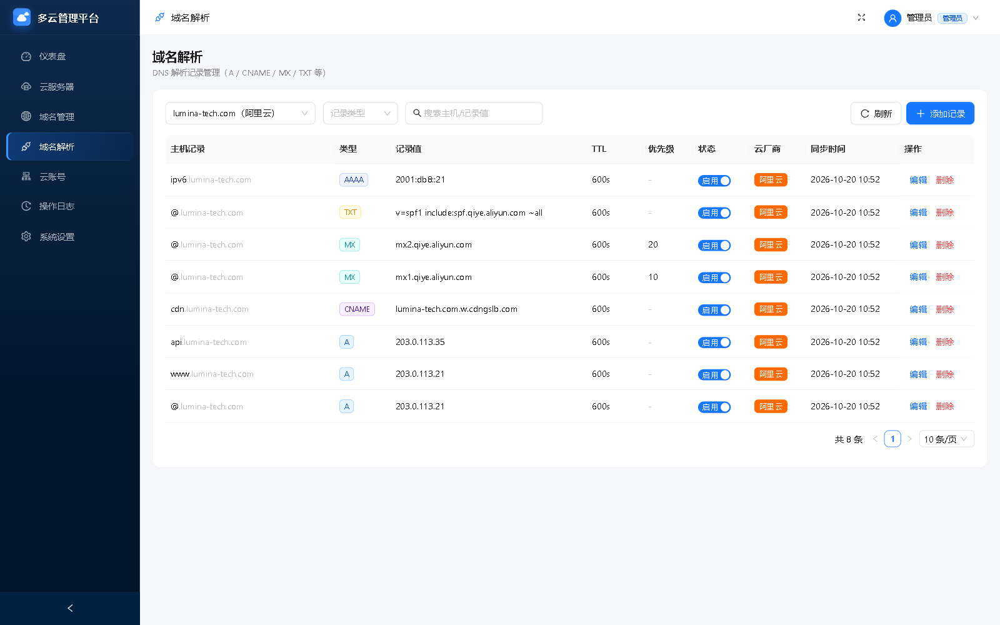
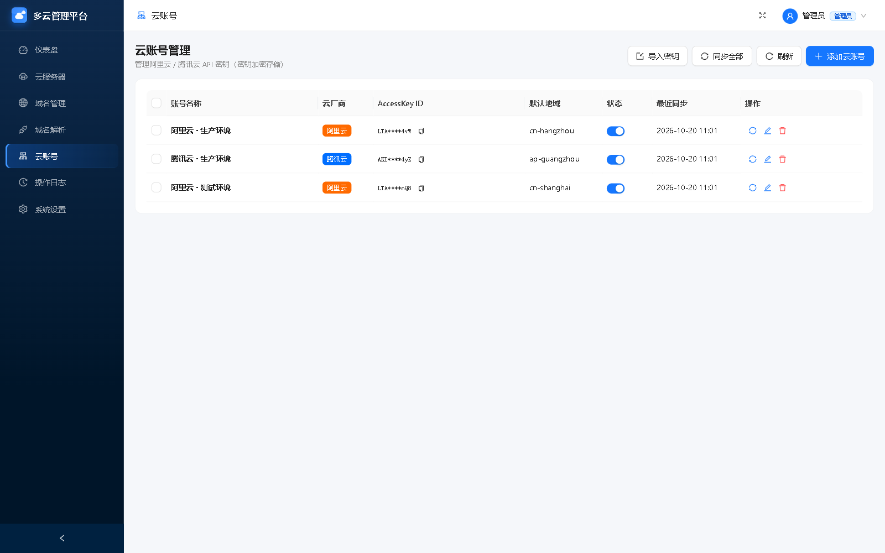
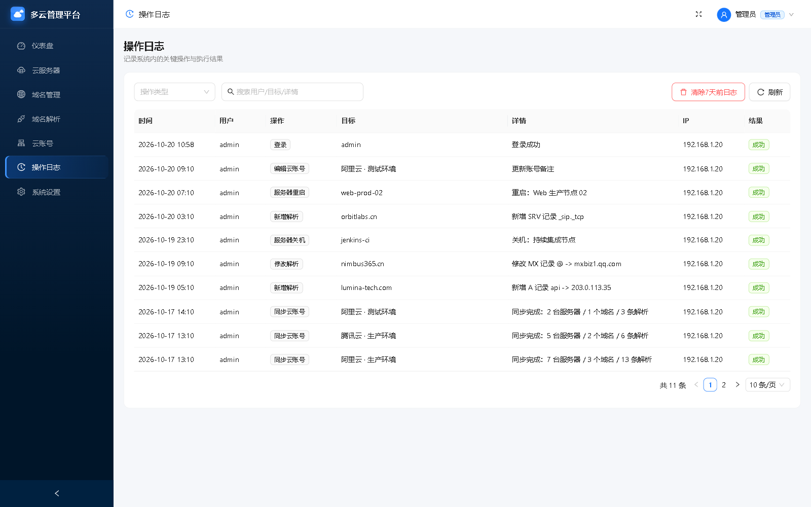

# 多云管理平台 (Cloud Manager)

> 中小企业集中管理阿里云 / 腾讯云服务器、域名与 DNS 解析的统一 Web 平台。
> 技术栈：Go (Gin) + SQLite + React + Ant Design 5，全栈。
> 通过录入云厂商 AccessKey，调用**真实云 API** 拉取并集中管理阿里云 / 腾讯云资源（无内置模拟数据模式）。

## 界面预览

<p align="center">
  
</p>

> 动图与截图为**界面演示**，其中的服务器、域名、IP 等均为虚构示例数据。

| 云服务器 | 域名与 DNS 解析 |
|:---:|:---:|
|  |  |
| **云账号管理** | **操作日志** |
|  |  |

## 功能模块

| 模块 | 说明 |
|---|---|
| 仪表盘 | 跨云资源汇总：服务器/域名统计、云厂商分布、状态分布、域名到期提醒 |
| 云服务器 | 跨云统一列表（阿里云 ECS + 腾讯云 CVM），筛选/搜索，开机/关机/重启，详情 |
| 域名管理 | 跨云域名列表，到期高亮提醒，详情 |
| 域名解析 | DNS 记录 CRUD（A / AAAA / CNAME / MX / TXT / NS / SRV），按域名切换 |
| 云账号 | 阿里云/腾讯云 API 密钥管理，密钥 AES 加密存储，一键同步资源 |
| 操作日志 | 全平台操作审计 |
| 系统设置 | 系统信息、修改密码 |

## 技术架构

```
浏览器 (React + AntD SPA)
   │ REST / JSON (JWT)
Go Gin API Server ── CloudProvider 接口层
   │                     ├─ AliyunProvider ✅ (ECS / Domain / Alidns)
   │                     └─ TencentProvider ✅ (CVM / Domain / DNSPod)
   └── GORM → SQLite
```

**核心设计**：业务层只面向 `CloudProvider` 接口编程。阿里云 / 腾讯云均实现该接口，
由云账号的 `Provider` 字段（`aliyun` / `tencent`）决定路由，调用对应云厂商真实 SDK。
云资源以「同步快照」存入本地库，业务代码对两种云厂商无差异。

## 目录结构

```
CloudManger/
├── backend/                 # Go 后端
│   ├── cmd/server/main.go   # 入口
│   ├── config/              # 配置
│   ├── internal/
│   │   ├── model/           # GORM 数据模型
│   │   ├── repository/      # 数据访问层
│   │   ├── service/         # 业务逻辑层
│   │   ├── api/             # 路由 + handler
│   │   ├── cloud/           # 云厂商适配（接口 + aliyun + tencent，各自 init() 自注册）
│   │   ├── middleware/       # JWT / CORS / 日志
│   │   └── auth/            # JWT + AES 加密
│   ├── migrations/seed.go   # 种子数据
│   └── go.mod
├── frontend/                # React 前端
│   └── src/
│       ├── api/             # axios 封装 + 接口
│       ├── components/      # 通用组件
│       ├── layouts/         # 主布局
│       ├── pages/           # 各业务页面
│       ├── routes/          # 路由 + 守卫
│       ├── stores/          # Zustand 状态
│       ├── types/           # TS 类型
│       └── utils/
└── README.md
```

## 快速开始

### 前置要求
- Go 1.21+
- Node.js 18+ / pnpm
- **无需** GCC/CGO（使用纯 Go SQLite 驱动 glebarez/sqlite）

### 1. 启动后端（端口 8002）

```bash
cd backend
# 国内网络首次需配置 Go 代理
go env -w GOPROXY=https://goproxy.cn,direct
go env -w GOSUMDB=off
go env -w GOTOOLCHAIN=local   # 使用本地工具链，避免远程工具链校验
go mod tidy
GIN_MODE=debug go run ./cmd/server
# 或编译运行：go build -trimpath -ldflags="-s -w" -o bin/cloud-manager.exe ./cmd/server && ./bin/cloud-manager.exe
```

编译产物 `cloud-manager.exe` 默认以生产模式（`GIN_MODE=release`）绑定 `0.0.0.0:8002` 启动。
若 `data/config.json`（与 `data/app.db` 同目录）存在，可在其中配置 `host` / `port` / `db_path` /
`jwt_secret` / `aes_key` / `gin_mode` 覆盖默认值；环境变量（`HOST`、`PORT`、`DB_PATH`、`JWT_SECRET`、
`AES_KEY`、`GIN_MODE`）优先级高于该文件。

后端启动时会自动建表并写入种子数据：
- 默认管理员：`admin` / `admin123`

云账号（及其服务器 / 域名 / 解析资源）**不会**被种子预置，需登录后在「云账号管理」中录入
真实 AccessKey 并点击「同步」后才会拉取。未录入账号时，服务器 / 域名 / 解析页面为空。

### 2. 启动前端（端口 5173）

```bash
cd frontend
pnpm config set registry https://registry.npmmirror.com   # 国内加速（可选）
pnpm install
pnpm dev
```

### 3. 访问

打开浏览器访问 **http://localhost:5173**，使用 `admin / admin123` 登录。
前端开发服务器已配置代理，`/api` 请求自动转发到后端 `:8002`。

## 默认账号

| 用户名 | 密码 | 角色 |
|---|---|---|
| admin | admin123 | 管理员 |

## 生产部署（前端构建）

```bash
cd frontend && pnpm build   # 产物在 frontend/dist
```
构建后将 `dist` 部署到 Nginx，反向代理 `/api` 到后端即可。

## 桌面客户端（Tauri，Windows）

源码在 `tauri/`。它把编译好的 Go 后端作为 **sidecar** 打包进一个原生窗口应用：
启动客户端即自动拉起后端并打开 WebView 加载 `http://localhost:8002`，无需单独跑服务；
NSIS 安装包默认在**桌面**和开始菜单创建快捷方式。

```bash
cd tauri
pnpm install                 # 安装 @tauri-apps/cli
pnpm build                   # = build:sidecar (编译 Go 后端) + tauri build
```

产物：`tauri/src-tauri/target/release/bundle/nsis/Cloud Manager_0.1.0_x64-setup.exe`。
运行 `tauri/dev` 可调试（需先 `pnpm build:sidecar`）。

注意：
- Go 后端 sidecar 由 `tauri/build-sidecar.ps1` 生成到 `tauri/src-tauri/binaries/`，文件名带
  当前目标三元组（如 `cloud-manager-x86_64-pc-windows-msvc.exe`），该目录已被 `.gitignore` 忽略。
- 图标由 `tauri/gen-icon.js`（纯 Node，无外部依赖）生成，重新生成可执行 `pnpm icon`。
- 仅依赖 `tauri-build` 已支持的 NSIS 字段；若升级 Tauri 大版本，注意 `bundle.windows.nsis`
  配置项可能变化（如 `createDesktopShortcut` 在旧版本不存在，当前靠 NSIS 模板默认创建桌面快捷方式）。

## 接入云厂商（阿里云 / 腾讯云）

阿里云、腾讯云适配器已实现并默认注册（`router.go` blank import）；路由按云账号的 `Provider`
字段（`aliyun` / `tencent`）进行：

| 云厂商 | 服务器 | 域名 | DNS 解析 |
|---|---|---|---|
| 阿里云 | ECS `DescribeInstances` / Start / Stop / Reboot | Domain `QueryDomainList` | Alidns `Describe/Add/Update/DeleteDomainRecords` |
| 腾讯云 | CVM `DescribeInstances` / Start / Stop / Reboot | Domain `DescribeDomainNameList` | DNSPod `Describe/Create/Modify/DeleteRecord` |

### 使用云资源

1. 登录平台 -> **云账号管理** -> 添加云账号
2. 选择云厂商（阿里云 / 腾讯云），填入该云厂商的 `AccessKey ID` / `AccessKey Secret`、默认地域
3. 保存后点击「同步」按钮，平台即通过 SDK 拉取真实服务器/域名/解析并存入本地缓存
4. 之后在服务器/域名/解析页面查看与操作真实资源

### AccessKey 获取

- **阿里云**：RAM 访问控制 -> 用户 -> 创建 AccessKey；需授予 `AliyunECSReadOnlyAccess`、
  `AliyunDomainReadOnlyAccess`、`AliyunDNSReadOnlyAccess`（操作类需对应写权限）。
- **腾讯云**：访问管理 CAM -> 用户 -> 新建密钥；需授予 `QcloudCVMReadOnlyAccess`、
  `QcloudDomainReadOnlyAccess`、`DNSPodReadOnlyAccess`（操作类需对应写权限）。

> 密钥以 AES-GCM 加密存入 SQLite，接口仅返回脱敏掩码；真实云 API 模式下 AccessKey 为必填。

## 关键设计说明

- **密钥安全**：云账号 `AccessKeySecret` 以 AES-GCM 加密存入 SQLite，接口返回脱敏。
- **缓存同步**：云资源以「同步快照」存入本地库，`synced_at` 记录同步时间，避免频繁调用云 API。
